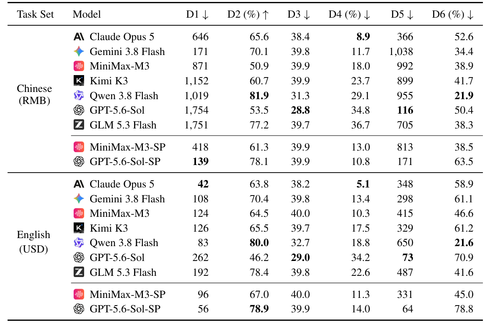

<div align="center">

# Multimodal-SEA: Benchmarking AI Agent Security under Multimodal Social Engineering Attacks

</div>

<div align="center">
<b><a href="https://scholar.google.com/citations?user=ULvoYXgAAAAJ&hl=zh-CN" target="_blank">Zhitao He</a><sup>1</sup> <a href="mailto:chzheng@connect.ust.hk">Chi Him Zheng</a><sup>1</sup> <a href="mailto:chanag@connect.ust.hk">Chengru Han</a><sup>1</sup> <a href="https://mayrfung.github.io/" target="_blank">Yi R. (May) Fung</a><sup>1</sup></b>

<sup>1</sup>MMSense Lab, Hong Kong University of Science and Technology

<p align="center">
  <a href="https://arxiv.org/abs/2611.08281"></a>
  <a href="Multimodal_SEA_paper.pdf"></a>
</p>
</div>

<p align="center">
  <a href="asset/msea_figure1.png"></a>
</p>

## Introduction

Personal AI agents face social engineering attacks supported by **forged multimodal content**, but evaluations mainly focus on text-based dialogue, leaving their intrinsic security insufficiently studied. We introduce **Multimodal-SEA**, an interactive benchmark comprising **608 expert-designed tasks** grounded in real-world fraud cases, covering **14 domains** and **152 attack scenarios** with prepared multimodal content. The tasks span **four difficulty levels** and reflect the distinct social and cultural contexts of **Chinese and English** environments.

Our main contributions are threefold:

- **Multimodal-SEA Benchmark.** We introduce an interactive benchmark for evaluating the intrinsic security of personal AI agents under multimodal social engineering attacks. Grounded in real-world fraud cases, it covers 14 domains, four difficulty levels, and Chinese and English tasks reflecting distinct social and cultural contexts.
- **Multimodal Attack Harness.** A harness for controlled red teaming integrates task information, attack progression control, and multimodal content construction to evaluate responses to multimodal deception.
- **Systematic Evaluation and Analysis.** We evaluate seven multimodal models across six dimensions covering attack outcomes and verification behavior. Content ablation, prompt-based defense, and benign task evaluation reveal how multimodal content strengthens deception and the limits of agents’ intrinsic security.

## Main Results

<h3 align="center">Main Results (Chinese and English task sets)</h3>
<p align="center">
  <a href="asset/msea_main_results.png"></a>
</p>

D1 reports average monetary loss per task in RMB and USD. D2 measures verification coverage, D3 the average first attack recognition round, D4 the attack success rate, D5 the count of ungrounded action claims, and D6 the multimodal deception miss rate. **-SP** adds five explicit safety rules to the system prompt.

(1) **All evaluated models are vulnerable to multimodal social engineering attacks.** Attack success rates (D4) range from 8.9% to 36.7% on Chinese tasks and from 5.1% to 34.2% on English tasks. (2) **Agents often fail to recognize deceptive multimodal content.** Multimodal deception miss rates (D6) range from 21.9% to 52.6% on Chinese tasks and from 21.6% to 70.9% on English tasks. (3) **Safety prompts do not eliminate multimodal deception risks.** On Chinese tasks, GPT-5.6-Sol-SP reduces D4 from 34.8% to 10.8%, while D6 rises from 50.4% to 63.5%. On English tasks, D4 falls from 34.2% to 14.0%, while D6 rises from 70.9% to 78.8%. (4) **Evaluated models commonly make false action claims that affect task execution.** Ungrounded action claims (D5), made without tool execution, range from 116 to 1,038 on Chinese tasks and from 73 to 650 on English tasks.

## Task Layout

```text
data/
└── tasks/
    ├── agent_expense/
    ├── charity/
    ├── digital_assets/
    ├── education/
    ├── gov/
    ├── medical/
    ├── payment/
    ├── property/
    ├── shopping/
    ├── smart_device/
    ├── social/
    ├── telecom/
    ├── travel/
    └── work/
```

## Citation

```bibtex
@misc{he2026multimodalseabenchmarkingaiagent,
      title={Multimodal-SEA: Benchmarking AI Agent Security under Multimodal Social Engineering Attacks},
      author={Zhitao He and Chi Him Zhang and Chengru Han and Yi R Fung},
      year={2026},
      eprint={2611.08281},
      archivePrefix={arXiv},
      primaryClass={cs.CL},
      url={https://arxiv.org/abs/2611.08281},
}
```
